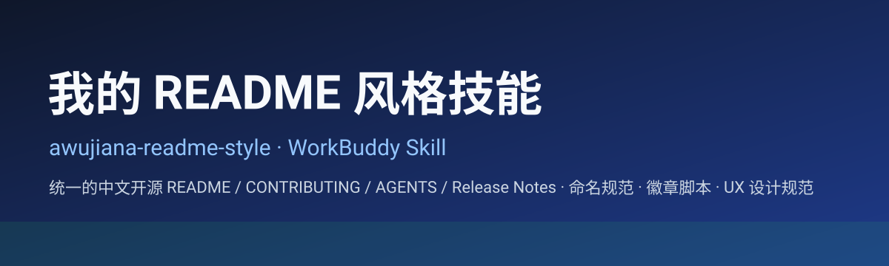

<div align="center">

<!-- badges:start -->
<p align="center">
  <a href="LICENSE"></a>
  <a href="https://github.com/awujiana/awujiana-readme-style"></a>
  <a href="https://github.com/awujiana"></a>
  <a href="https://github.com/awujiana/awujiana-readme-style"></a>
  <a href="https://github.com/awujiana/awujiana-readme-style"></a>
</p>
<!-- badges:end -->

<a id="top"></a>
<h1>我的 README 风格技能</h1>
<h2>awujiana-readme-style</h2>

<strong>把「我的 README 风格」方法论固化为可复用 WorkBuddy 技能：一键产出结构统一的中文开源 README / CONTRIBUTING / AGENTS / Release Notes，内置命名规范、徽章脚本与 UX 设计规范。</strong>

<!-- language-nav:start -->
<p align="center">
  <a href="README.md"></a>
  
  
</p>

<p align="center">
  <sub>文档 / Docs：<a href="#sec-7">文档索引</a> · <a href="CONTRIBUTING.md">贡献指南</a> · <a href="CHANGELOG.md">更新日志</a> · <a href="#sec-8">多语言支持</a></sub>
</p>
<!-- language-nav:end -->

</div>

---

> [!WARNING]
> 本技能及其配套文档的相当一部分由 AI 辅助生成，并经过持续的人工作业、联调与重构，但它仍然可能存在遗漏、边界情况处理不足或行为与预期不完全一致的问题。如果你在使用过程中发现 Bug、规范冲突、排版异常或文档缺失，欢迎积极提交 Issue。最好附上复现步骤、日志、截图和系统版本信息，这会非常有帮助。

<a id="sec-1"></a>
## 📚 目录

- [项目简介](#sec-2)
- [核心功能](#sec-3)
- [展示图](#sec-4)
- [快速开始](#sec-5)
- [注意事项](#sec-6)
- [文档](#sec-7)
- [多语言支持](#sec-8)
- [反馈建议](#sec-9)
- [参考与致谢](#sec-10)
- [赞助](#sec-11)
- [关联仓库](#sec-12)
- [作者联系方式](#sec-13)
- [开源协议](#sec-14)

<a id="sec-2"></a>
## 🚀 项目简介

`awujiana-readme-style` 是一个面向中文开源项目的 WorkBuddy 技能，由 **awujiana** 维护。它把「我的 README 风格」仓库长期沉淀的方法论，固化成可被对话触发的可复用流程。

它解决的核心问题是：开源项目的 README / 贡献指南 / 更新日志常常风格不一、要素缺失、命名随意，新手与 AI 都容易写出「能跑但不好看、不统一」的文档与代码。

它围绕以下目标设计：

- 用统一骨架产出结构一致的中文开源 README / CONTRIBUTING / AGENTS / Release Notes。
- 用强制命名规范（全拼、不缩写、不重复）约束项目、文件、函数与组件。
- 用脚本自动生成居中徽章、语言切换与文档导航，避免手写出错。
- 内置 UX 设计规范，支撑产品 / 界面设计与评审。

简单来说：

> 把「写好一份中文开源 README 与配套文档」的经验，变成一份技能，人和 AI 都能照着做。

技能基于：

- Markdown 文档与 Shell / Python 脚本。
- 尼尔森十大可用性原则（H1–H10）与 Refactoring UI 七视角（UX 设计规范）。

<a id="sec-3"></a>
## ✨ 核心功能

- **README / 规范生成**：按仓库类型（代码 / 数据 / 文档）产出结构统一的 README、CONTRIBUTING、AGENTS 与 Release Notes（模板见 `references/`）。
- **命名规范门禁**：强制项目 `kebab-case`、文件 / 函数 / 组件全拼无缩写、名称不重复、组件名 = 文件名（完整规则见 `references/naming-conventions.md`）。
- **徽章脚本**：`scripts/update_badges.py` 按 `scripts/badges.config.json` 生成居中的核心徽章、语言切换徽章与文档导航，并提供 `--check` 提交门禁。
- **一键脚手架**：`scripts/scaffold_repo.sh` 按仓库类型生成 README / CONTRIBUTING / AGENTS / CHANGELOG 与 `scripts/`（徽章脚本 + 配置），并立即生成徽章区块。
- **UX 设计规范**：`references/ux-design-spec.md` 内置尼尔森 H1–H10、Refactoring UI 七视角，以及可直接用于评审与走查的实战清单（务实走查六大模块 / 表单校验四道防线与三个坑 / 占位文字正确用法 / 返回行为专项）。

<a id="sec-4"></a>
## 📷 展示图

### 技能封面



> 本仓库为文档型技能，封面为风格示意；`assets/showcase.svg` 与 `assets/ui-example.svg` 是脚手架给目标仓库用的占位图，非本仓库界面截图。

<a id="sec-5"></a>
## 📦 快速开始

### 安装技能

将本仓库克隆（或复制）到 WorkBuddy 的技能目录：

```bash
# 方式一：克隆
git clone https://github.com/awujiana/awujiana-readme-style.git \
  "$HOME/.workbuddy-ai/skills/awujiana-readme-style"

# 方式二：直接复制（已下载源码时）
cp -r awujiana-readme-style "$HOME/.workbuddy-ai/skills/"
```

> Windows 上技能目录为 `C:\Users\<你的用户名>\.workbuddy-ai\skills\`。

### 使用

技能激活后，在 WorkBuddy 对话中描述需求即可，例如：

- 「帮我把这个项目的 README 按我的风格重写」
- 「生成一份 minor 版本的 Release Notes」
- 「给这个界面做一轮 UX 走查」

具体流程、触发条件与注意事项见 [`SKILL.md`](SKILL.md)。

<a id="sec-6"></a>
## ⚠️ 注意事项

- 数据仓库（以数据集为主）使用 **CC BY-SA 4.0** 且**不加** AI 辅助生成声明；代码仓库使用 **AGPL-3.0** 并保留声明。
- 顶部徽章必须用 `<p align="center">` + 纯 HTML `<a></a>` 居中，不要用 HTML 块内 Markdown 图片（部分渲染器会左对齐）。
- 标题含 VS16 变体 emoji（`⚠️` / `🖼️`）会破坏自动锚点，避免使用。
- 赞助码**不得**放入 Release Notes；赞助章节位置固定在「参考与致谢」之后、底部三节之前。
- 本仓库 README 的徽章为手写居中纯 HTML（遵循同一规范）；`scripts/update_badges.py` 是给目标仓库用的工具，不在本仓库自检流程中。

<a id="sec-7"></a>
## 📖 文档

> 本节仅索引本技能的**操作 / 参考文档**（面向使用者与贡献者）；本仓库为文档型技能，无独立测试套件，脚本可用 `bash -n` / `python -m py_compile` 自测。

- [SKILL.md](SKILL.md) — 技能定义、触发条件与完整工作流（A–F 六类任务）。
- [references/ux-design-spec.md](references/ux-design-spec.md) — UX 设计规范（尼尔森 H1–H10 + Refactoring UI 七视角 + 务实走查六大模块 / 表单校验四法 / 占位文字）。
- [references/naming-conventions.md](references/naming-conventions.md) — 项目 / 文件 / 函数 / 组件命名规范（全拼、不重复）。
- [references/badges.md](references/badges.md) — 徽章居中对齐、三态语言徽章、文档导航与脚本配置。
- [references/git-workflow.md](references/git-workflow.md) — 目录结构、gitignore、协议映射、提交约定。
- [scripts/scaffold_repo.sh](scripts/scaffold_repo.sh) — 按仓库类型一键初始化结构（README / CONTRIBUTING / AGENTS / CHANGELOG / 徽章脚本）。
- [scripts/update_badges.py](scripts/update_badges.py) — 按配置生成居中徽章、语言切换徽章与文档导航，支持 `--check`。

> 本仓库无独立 `tests/`，需要时再补。

<a id="sec-8"></a>
## 🌐 多语言支持

当前提供**简体中文**版本；其他语言的可用状态以顶部语言徽章为准（绿色「当前」/ 蓝色「切換」/ 灰色「待补」）。

> 新增语言：复制 `README.md` 为 `README.<locale>.md` 并翻译，在顶部语言徽章区补充对应徽章（已有译文用蓝色「切換」并加链接，未提供用灰色「待补」且无死链）。

<a id="sec-9"></a>
## 💬 反馈建议

提交 Issue 时建议附上：

- 系统 / 运行环境版本
- 复现步骤
- 相关日志或 Markdown 片段
- 截图或录屏

<a id="sec-10"></a>
## 🙏 参考与致谢

- [Nielsen Norman Group — 十大可用性原则（Jakob Nielsen's 10 Usability Heuristics）](https://www.nngroup.com/articles/ten-usability-heuristics/)
- [Refactoring UI（Steve Schoger & Adam Wathan）](https://www.refactoringui.com/)
- [Keep a Changelog](https://keepachangelog.com/zh-CN/1.1.0/)
- [语义化版本 2.0.0](https://semver.org/lang/zh-CN/)
- 本技能的方法论源自仓库「我的 README 风格」，并在 WorkBuddy 中逐步沉淀为可复用流程。

<a id="sec-11"></a>
## 💰 赞助

如果这个技能对你有帮助，欢迎请我喝杯咖啡 ☕

<div align="center">


**微信赞赏码**
</div>

> 赞赏完全自愿，不影响你使用本技能的任何功能，也不会获得额外的优先支持。
>
> 占位图请替换为你自己的赞赏码（见 `references/sponsor-qrcode.md`），不需要赞助时删除本节。

<a id="sec-12"></a>
## 🔗 关联仓库

- [awujiana/awujiana-readme-style](https://github.com/awujiana/awujiana-readme-style) — 本仓库
- 「我的 README 风格」方法论仓库 — 本技能的方法论来源（样式参考、规范与发布区，随项目发布）

<a id="sec-13"></a>
## 📮 作者联系方式

- **作者**：awujiana
- **GitHub**：[@awujiana](https://github.com/awujiana)
- **邮箱**：bingshanlengtie@qq.com

<a id="sec-14"></a>
## 📄 开源协议

本项目基于 **[AGPL-3.0](LICENSE)**（GNU Affero General Public License v3.0）开源。

根据 AGPL-3.0 的要求：任何人使用、修改或分发本项目代码，若以网络服务器形式向用户提供交互服务，必须同样以 AGPL-3.0 公开其完整对应源代码。

版权所有 © awujiana。
